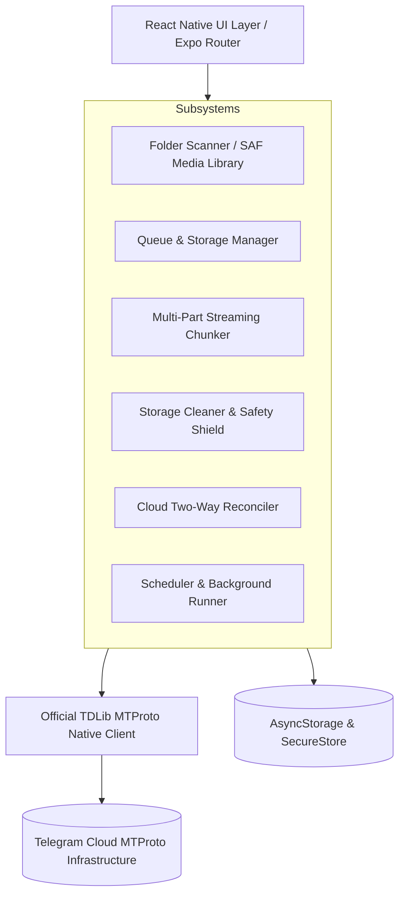

# Nimo Save Storage — Technical Architecture

This document provides a detailed technical overview of **Nimo Save Storage**, explaining its core subsystems, data flow, background task execution, storage schemas, and Telegram TDLib integration.

---

## 1. High-Level System Architecture



---

## 2. Core Subsystems

### 2.1 Direct TDLib / MTProto Client (`src/lib/tdlib/client.ts`)
* **Transport**: Direct native bindings via `react-native-tdlib` communicating over encrypted MTProto TCP/binary protocols directly to Telegram DC (Data Center) servers.
* **Authentication Flow**:
  * Phone Number entry -> Telegram sends official verification code via SMS/app.
  * Code entry -> Two-Step Verification (2FA cloud password) if enabled.
  * Sessions, keys, and tokens are stored in hardware-encrypted keystores via `expo-secure-store`.
* **Zero Intermediaries**: No third-party servers, bot proxies, or web scrapers exist. Credentials and file streams never touch any server other than Telegram's official infrastructure.

---

### 2.2 Multi-Part Streaming Chunker (`src/lib/upload/chunker.ts`)
Telegram limits single-file uploads to **1.95 GB** for standard accounts (or 4 GB for Telegram Premium). To seamlessly handle massive 4K raw videos, disk images, and backups:
1. **Size Detection**: Files with size > 1.95 GB (configurable up to 3.9 GB) are automatically intercepted before upload.
2. **Streaming Buffer**: Uses a **16 MB read/write streaming buffer** with `expo-file-system/legacy` to avoid loading gigabytes into JS memory.
3. **Sequential Parts**: Slices the source file into `.part001`, `.part002`, etc., in the app's sandboxed cache directory.
4. **Cryptographic Manifest**: Generates a `ChunkManifest`:
   ```ts
   interface ChunkManifest {
     parentFileName: string;
     parentSize: number;
     parentHash?: string;
     totalParts: number;
     parts: {
       partIndex: number;
       fileName: string;
       size: number;
       uri: string;
       telegramMessageId?: number;
     }[];
     createdAt: number;
   }
   ```
5. **On-Demand Reassembly (`src/lib/storage/reassembler.ts`)**: When restoring or sharing a split file, the reassembler streams the parts back into a single continuous file.

---

### 2.3 Cloud Sync & Safety Shield (`src/lib/storage/cloudSync.ts` & `cleaner.ts`)
* **Two-Way Reconciliation**: Periodically verifies that records stored in `@nimo/uploaded` still physically exist in the target Telegram chat using `checkMessagesBatch()`.
* **Missing Cloud Detection**: If a user deletes a file from Telegram (via desktop or mobile app), Nimo marks the local record as `missing_in_cloud`, flags it in the Cloud Explorer, and offers 1-tap re-upload if the local file still exists.
* **Device Cleaner Safety Shield**:
  * Before deleting local media to free up device space, the cleaner queries Telegram's servers to guarantee the message ID still exists.
  * If a file was removed from Telegram, deletion is **aborted** (`blockedCount`), safeguarding against data loss.
* **Reverse Cloud Discovery**: Reads recent chat history (`getChatHistory()`) to index files uploaded to Saved Messages from PCs or other devices.

---

### 2.4 Scheduler & Background Runner (`src/lib/scheduler/schedulerEngine.ts`)
* **Trigger Modes**:
  1. **Interval**: Periodic recurring execution (e.g. every 1m, 15m, 1h).
  2. **Night Window**: Constrained to specific hours (e.g. 22:00 to 06:00, including midnight-spanning ranges).
  3. **Continuous**: Instant reactive backup while the app is active.
* **Hardware Guards**:
  * **Battery Guard**: Pauses scans and transfers if device battery drops below threshold (e.g. 20%).
  * **Charging Gate**: Restricts execution to AC or USB power.
  * **Network Gate**: Restricts transfers to unmetered Wi-Fi connections via `@react-native-community/netinfo`.
* **Native Task Manager**: Registered with Android's system job scheduler using `expo-background-task` and `expo-task-manager` (`src/tasks/backgroundUpload.ts`).

---

## 3. Storage Architecture & Keys

| Storage Type | Key / Identifier | Description |
|---|---|---|
| **AsyncStorage** | `@nimo/config` | Application preferences, mode, filters, target chat ID, guards |
| **AsyncStorage** | `@nimo/queue` | Array of pending, uploading, paused, or failed `QueueItem` objects |
| **AsyncStorage** | `@nimo/uploaded` | Array of verified cloud backups (`UploadedRecord`) |
| **AsyncStorage** | `@nimo/action_history` | Historical log of uploads, deletions, and retries |
| **AsyncStorage** | `@nimo/scheduler_state` | Last run timestamp, summary, status, and skip reasons |
| **AsyncStorage** | `@nimo/chunk_manifests` | Mapping of split-file manifests and part linkages |
| **SecureStore** | `@nimo/tg_session` | Encrypted TDLib authorization keys and session data |
| **SecureStore** | `@nimo/security_prefs` | Biometric lock status and security hash |

---

## 4. Error Handling & Recovery

1. **Upload Interruption Recovery**: On app launch (`RootLayout`), `recoverInterruptedUploads()` resets any stuck `'uploading'` items back to `'pending'` and clears orphaned staging files.
2. **SAF Media Scanner**: Handles Android 11+ scoped storage permissions with permission request prompts and graceful degradation.
3. **Log Interception (`src/app/logs.tsx`)**: Replaces standard `console.log/warn/error` with a cyclic buffer for real-time in-app filtering and log export.
